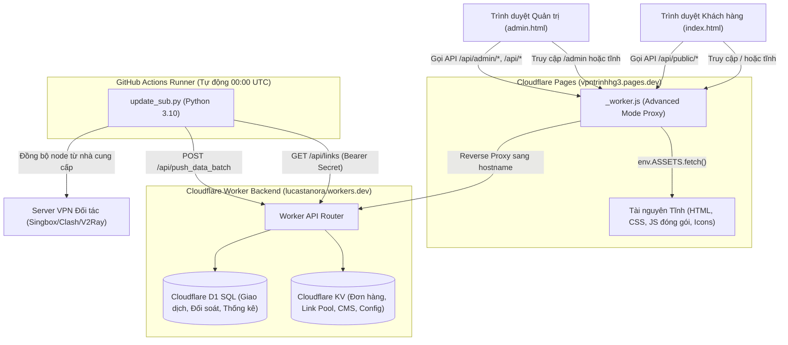
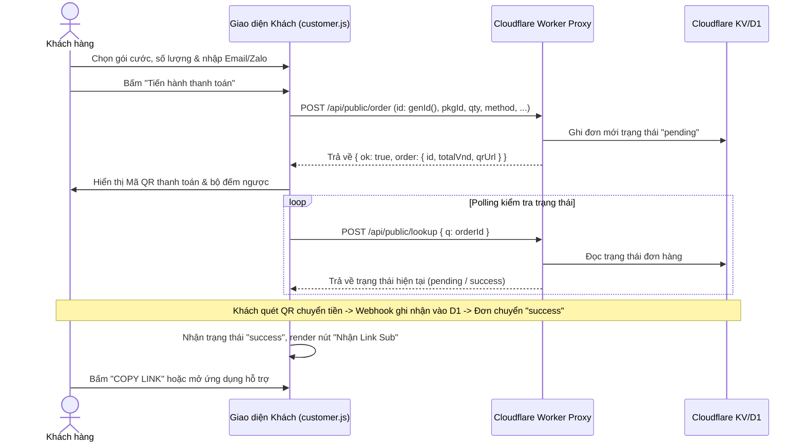

# PROJECT_MAP.md — BẢN ĐỒ KIẾN TRÚC & NGHIỆP VỤ DỰ ÁN VPNTRINHHG3

> **Phiên bản:** 1.0 (Khởi tạo Giai đoạn 0 — Vite Migration)  
> **Repository:** `trinhhg/vpntrinhhg3`  
> **Production Branch:** `main` | **Working Branch:** `refactor/vite-migration`  
> **Mục đích:** Cung cấp bức tranh toàn cảnh chính xác 100% về kiến trúc mã nguồn, bản đồ endpoint, mô hình dữ liệu, cơ chế xác thực và các quy trình nghiệp vụ của VPNTrinhHg.

---

## 1. TỔNG QUAN HỆ THỐNG VÀ KIẾN TRÚC LUỒNG DỮ LIỆU

Website VPNTrinhHg3 là hệ thống kinh doanh dịch vụ VPN tự động hóa, bao gồm 2 giao diện độc lập (Khách hàng & Quản trị) hoạt động trên nền tảng **Cloudflare Pages**, kết nối với **Cloudflare Worker** chuyên dụng (`vpntrinhhg3worker.lucastanora.workers.dev`) thông qua cơ chế Proxy Worker (`_worker.js`).



---

## 2. VAI TRÒ CỦA HAI TRANG HTML HIỆN TẠI

1. **`index.html` (~2.673 dòng | ~199 KB):**  
   - Cổng giao diện khách hàng (Customer Portal & Storefront).
   - Hiển thị danh sách gói cước VPN (theo ngày/tháng, dung lượng GB, giá VND/CNY/USD).
   - Form đặt hàng, tạo mã QR thanh toán ngân hàng/MoMo/Alipay/WeChat Pay.
   - Cơ chế kiểm tra trạng thái thanh toán tự động (polling).
   - Tra cứu đơn hàng bằng Mã đơn hoặc Email (`/portal/order`).
   - Cổng kích hoạt, hiển thị Link Sub VPN cho khách sau khi đơn thành công.
   - Thư viện hướng dẫn cài đặt trên đa thiết bị (iOS, Android, Windows, macOS).
   - Hệ thống đa ngôn ngữ tự động (Tiếng Việt `vi`, Tiếng Anh `en`, Tiếng Trung `zh`).
   - Hỗ trợ cài đặt PWA di động (`manifest.json`, icon maskable).

2. **`admin.html` (~5.636 dòng | ~405 KB):**  
   - Bảng điều khiển quản trị toàn diện (Admin Control Panel).
   - Đăng nhập xác thực quản trị viên bằng mật khẩu và định danh thiết bị (`myDev`).
   - Quản lý đơn hàng: Tạo mới, Chỉnh sửa, Đổi trạng thái, Xóa, Khóa fulfillment.
   - Quản lý Link Pool (Kho tổng node) & Link Sub (Link phân phối cho khách).
   - Quản lý gói cước (Packages DB: hỗ trợ cả gói hiện hành và gói giá lịch sử).
   - Quản lý doanh thu, đối soát giao dịch D1 (drill-down ngân hàng, Alipay, WeChat).
   - Email Composer: Hệ thống gửi email thông báo khách (5 mẫu tự động + mẫu tự do).
   - CMS Hướng dẫn: Quản lý bài viết hướng dẫn bằng trình soạn thảo Quill và DOMPurify.
   - Trung tâm cài đặt hệ thống: Quản lý thiết bị đã cấp quyền, cấu hình Cron, Quota monitor, Test Mode và sao lưu Telegram.

---

## 3. KIẾN TRÚC MỤC TIÊU 4 MODULE JAVASCRIPT & 2 FILE CSS

Thay vì chia nhỏ thành hàng chục file vụn vặt gây khó khăn cho việc đồng bộ, dự án quy hoạch tối giản thành **4 module JavaScript chính** và **2 file CSS**:

```
vpntrinhhg3/
│
├── index.html              <-- HTML Entry khách hàng
├── admin.html              <-- HTML Entry quản trị
│
├── src/
│   ├── api.js              <-- Duy nhất phụ trách giao tiếp API, timeout, error handling
│   ├── shared.js           <-- Hàm dùng chung (Format tiền tệ, ngày giờ, escape, toast)
│   ├── customer.js         <-- Toàn bộ nghiệp vụ khách hàng (Đặt hàng, QR, tra cứu, i18n)
│   ├── admin.js            <-- Toàn bộ nghiệp vụ quản trị (Đơn, Link Sub, Doanh thu, CMS)
│   ├── customer.css        <-- CSS khách hàng (Tailwind build + custom animations)
│   └── admin.css           <-- CSS quản trị (Tailwind build + Glass UI + Quill/Grid styling)
│
├── public/                 <-- Tài nguyên phục vụ trực tiếp vào dist/
│   ├── _worker.js          <-- Cloudflare Pages proxy worker
│   ├── _redirects          <-- Routing fallback rule
│   ├── manifest.json       <-- PWA khách hàng
│   ├── manifestadmin.json  <-- PWA quản trị
│   ├── icon-192.png        <-- App icon 192x192
│   └── icon-512.png        <-- App icon 512x512
│
├── tests/
│   ├── core.test.js        <-- Unit tests cho các hàm tính toán, format, helper
│   └── website.spec.js     <-- E2E browser tests (Playwright)
│
├── package.json            <-- Quản lý dependencies (pin exact versions)
├── vite.config.js          <-- Cấu hình Multi-page build Vite
├── tailwind.config.js      <-- Cấu hình Tailwind nội bộ (loại bỏ CDN)
├── AGENTS.md               <-- 80 quy tắc an toàn bảo vệ dự án
├── PROJECT_MAP.md          <-- Bản đồ hệ thống (file này)
└── CHANGELOG.md            <-- Lịch sử thay đổi dự án
```

### Chi tiết trách nhiệm từng module:
1. **`src/api.js`:**
   - Điểm vào duy nhất cho mọi request mạng (`fetch`).
   - Cấu hình `WORKER_URL` (`https://vpntrinhhg3worker.lucastanora.workers.dev`).
   - Xử lý timeout, chuẩn hóa thông báo lỗi HTTP, xử lý phản hồi JSON an toàn.
   - Tự động gắn header `Authorization: Bearer <TOKEN>` cho các yêu cầu admin.
   - Hỗ trợ tham số `test=1` hoặc header `X-Test-Mode` khi ở chế độ thử nghiệm.
   - **Quy tắc an toàn:** Không tự ý retry mù quáng với các API ghi dữ liệu (`/api/public/order`, `/api/public/upgrade`, fulfillment). Chỉ cho phép retry với các request GET hoặc đã xác nhận an toàn.

2. **`src/shared.js`:**
   - Format tiền tệ chuẩn xác qua `currency.js` (VND, CNY, USD; hỗ trợ phân cách hàng nghìn).
   - Xử lý ngày giờ và múi giờ chính xác bằng `Day.js` (`customParseFormat`, `utc`, `timezone`) với múi giờ mặc định `Asia/Ho_Chi_Minh` (hoặc `Asia/Shanghai`).
   - Hàm tiện ích DOM: Selector helper `$()`, escape ký tự đặc biệt HTML `esc()`.
   - Làm sạch HTML bằng `DOMPurify` để ngăn chặn lỗ hổng XSS.
   - Trình bao bọc thông báo SweetAlert2 (`toast`, `Toast.fire`).
   - Quản lý theme giao diện (Dark / Light mode) và lưu trữ trạng thái `vpn_theme`.

3. **`src/customer.js`:**
   - Trực tiếp quản lý DOM và nghiệp vụ trang `index.html`.
   - Quản lý danh sách gói cước (`PKG_LIST`), tính giá động khi nhân hệ số số lượng/tháng.
   - Xử lý luồng đặt hàng (Checkout), chọn cổng thanh toán (QR Ngân hàng / MoMo / Crypto / AliPay / WeChat).
   - Polling trạng thái đơn hàng sau khi tạo QR ticket.
   - Tra cứu portal khách hàng theo `orderId` hoặc `email`, hiển thị thông tin gói cước và ngày hết hạn.
   - Kích hoạt Link Sub VPN và hướng dẫn copy link.
   - Router phía client (`Navigo`) điều hướng mượt mà: `/`, `/portal/order`, `/portal/packages`, `/portal/guide`, `/policy`.
   - Hệ thống i18n: Tự động dịch giao diện sang `vi`, `en`, `zh` từ KV qua API `/api/public/translations`.

4. **`src/admin.js`:**
   - Trực tiếp quản lý bảng điều khiển `admin.html`.
   - Quản lý đăng nhập xác thực, lưu token phiên và định danh thiết bị (`myDev`).
   - Quản lý Tab: Đơn hàng, Kiểm tra fulfillment, Giao dịch D1, Link Sub, Kho tổng Link Pool, Gói cước, Soạn mail, CMS Hướng dẫn, Cài đặt hệ thống.
   - Biểu đồ thống kê doanh thu đa chiều bằng `Chart.js` (thay thế ApexCharts theo chuẩn Open Source MIT).
   - Trình soạn thảo hướng dẫn trực quan bằng `Quill`.
   - Bảng hiển thị và lọc dữ liệu bằng `Grid.js`.
   - Quản lý đồng bộ: Nút đồng bộ thủ công sang GitHub Actions (`/api/trigger_github`), kiểm tra hạn mức quota Cloudflare (`/api/admin/quota`), dọn rác KV (`/api/gc`).

---

## 4. BẢN ĐỒ CHI TIẾT ENDPOINTS VÀ WORKER PROXY

### 4.1. Worker Proxy Routing (`_worker.js`)
File `_worker.js` chạy trên Cloudflare Pages Advanced Mode. Quy tắc chuyển hướng:
- **Proxy sang Worker Backend (`https://vpntrinhhg3worker.lucastanora.workers.dev`):**
  - Mọi request bắt đầu bằng `/api/`
  - Mọi request bắt đầu bằng `/qr`
  - Mọi request khớp mẫu `/^\/v[1-6]/` (Subscription routes: `/v1/*` đến `/v6/*`)
- **Phục vụ tài nguyên tĩnh (Static Assets):**
  - Tất cả các request còn lại được xử lý bằng `env.ASSETS.fetch(request)`.

### 4.2. Danh mục 8 Customer Endpoints (`index.html`)

| STT | Endpoint | Method | Chức năng & Tham số |
|:---:|:---|:---:|:---|
| 1 | `/api/public/translations` | GET | Tải bảng từ vựng đa ngôn ngữ (vi, en, zh) từ KV để dịch tự động giao diện. Query: `?_t=timestamp`. |
| 2 | `/api/public/config` | GET | Tải cấu hình công khai của website (các khối giao diện, routing, banner, trạng thái bảo trì). |
| 3 | `/api/public/qr_ticket` | POST | Tạo mã vé QR thanh toán cho liên kết mua gói. Body: `{ url }`. |
| 4 | `/api/public/qr_cancel` | POST | Hủy phiên QR đang chờ khi khách hàng đóng modal hoặc đổi gói. Body: `{ ticket }`. |
| 5 | `/api/public/order` | POST | Tạo mới đơn hàng mua gói VPN. Body: `{ id, email, zalo, pkgId, qty, method, needSupport, sourceWeb, renewOf }`. |
| 6 | `/api/public/upgrade` | POST | Nâng cấp gói cước cho đơn hàng đang hoạt động. Body: `{ orderId, pkgId, qty, method }`. |
| 7 | `/api/public/lookup` | POST | Tra cứu thông tin đơn hàng và Link VPN theo Mã Đơn hoặc Email. Body: `{ q: orderIdOrEmail }`. |
| 8 | `/api/public/data_request` | POST | Gửi yêu cầu kiểm tra và báo cáo dung lượng data đã sử dụng về email cho khách. Body: `{ orderId }`. |

### 4.3. Danh mục 41 Admin Endpoints (`admin.html`)

| STT | Endpoint | Method | Chức năng & Mô tả chi tiết |
|:---:|:---|:---:|:---|
| 1 | `/api/admin/login` | POST | Xác thực mật khẩu quản trị và cấp JWT Token. Body: `{ password, dev: { id, ua } }`. |
| 2 | `/api/admin/poll` | GET | Lấy nhanh dữ liệu tổng hợp phục vụ hiển thị dashboard: orders, links, pool, data_requests. |
| 3 | `/api/admin/status` | GET | Đọc trạng thái máy chủ Worker, thời gian thực tế của server, offset simMode và tiến trình Cron. |
| 4 | `/api/admin/quota` | GET | Giám sát dung lượng và số lượng request đã sử dụng trong ngày của Cloudflare KV, D1, Workers. |
| 5 | `/api/admin/logs` | GET | Đọc danh sách bản ghi nhật ký sự kiện hệ thống đã lưu trên KV. |
| 6 | `/api/admin/log` | POST | Ghi nhận 1 sự kiện hoạt động của admin vào nhật ký. Body: `{ lvl, act, msg, ref }`. |
| 7 | `/api/admin/log_batch` | POST | Ghi đồng thời một mảng các bản ghi nhật ký để tiết kiệm số lần ghi KV. Body: `{ logs: [...] }`. |
| 8 | `/api/admin/order` | POST | Tạo mới hoặc cập nhật thông tin đơn hàng (ID, email, trạng thái, ngày hết hạn, fulfillment). |
| 9 | `/api/admin/order` | DELETE | Xóa vĩnh viễn đơn hàng khỏi cơ sở dữ liệu. Query: `?id=ORDER_ID`. |
| 10 | `/api/admin/heal` | POST | Kích hoạt logic tự sửa fulfillment cho một hoặc danh sách đơn hàng. Body: `{ orderIds: [...] }`. |
| 11 | `/api/admin/send_mail` | POST | Gửi email thông báo cho khách hàng qua Mail Provider (Resend/SendGrid/SMTP). Body: `{ to, subject, html }`. |
| 12 | `/api/admin/tx` | GET | Lấy danh sách lịch sử giao dịch thanh toán từ cơ sở dữ liệu SQL Cloudflare D1. Query: `?status=all&limit=100&updated_since=...`. |
| 13 | `/api/admin/tx/:id/delete` | POST | Xóa bản ghi giao dịch thật trong cơ sở dữ liệu D1. |
| 14 | `/api/admin/relink` | POST | Rà quét kiểm tra hoặc áp dụng gán lại liên kết (remap links) giữa các node VPN. Body: `{ action, mode, picks, ... }`. |
| 15 | `/api/admin/save_links_and_pool` | POST | Lưu đồng thời danh sách Link Sub và Link Pool trong một transaction nguyên tử. Body: `{ links, pool }`. |
| 16 | `/api/admin/link/delete` | POST | Xóa một link phân phối khỏi hệ thống và đưa vào danh sách mộ (tombstone). |
| 17 | `/api/admin/source/delete` | POST | Xóa một nguồn node gốc khỏi kho. Body: `{ id, url, url2 }`. |
| 18 | `/api/admin/source/clean_unused` | POST | Quét và dọn dẹp sạch các nguồn node gốc không còn đơn hàng nào sử dụng. |
| 19 | `/api/admin/cron` | POST | Kích hoạt thủ công tiến trình dọn dẹp tự động (khóa hạn, luân chuyển node, xóa node rác, gửi email nhắc). |
| 20 | `/api/admin/migrate_dates` | POST | Công cụ migration: Quét hoặc chuẩn hóa định dạng ngày tháng sang ISO/DD-MM-YYYY chuẩn. Body: `{ apply: boolean }`. |
| 21 | `/api/admin/migrate_pkg` | POST | Công cụ migration: Quét hoặc chuẩn hóa mã gói cước của các đơn hàng cũ. Body: `{ apply: boolean }`. |
| 22 | `/api/admin/fulfillment_config` | GET | Lấy cấu hình tự động phân bổ node fulfillment theo từng gói cước. |
| 23 | `/api/admin/fulfillment_config` | POST | Cập nhật quy tắc fulfillment tự động cho các gói cước. Body: `{ config }`. |
| 24 | `/api/admin/test/status` | GET | Kiểm tra trạng thái hiện tại của chế độ thử nghiệm (Test Mode). |
| 25 | `/api/admin/test/toggle` | POST | Bật hoặc tắt môi trường dữ liệu thử nghiệm độc lập. Body: `{ active: boolean }`. |
| 26 | `/api/admin/test/fake_order` | POST | Sinh đơn hàng giả lập ngẫu nhiên trong môi trường test để kiểm tra luồng xử lý. |
| 27 | `/api/admin/test/clone` | POST | Sao chép toàn bộ dữ liệu từ môi trường thật sang môi trường test để kiểm thử an toàn. |
| 28 | `/api/admin/test/clear` | POST | Xóa sạch toàn bộ dữ liệu thử nghiệm trong môi trường test. |
| 29 | `/api/admin/telegram/test` | POST | Gửi tin nhắn test kiểm tra kết nối với Bot Telegram quản trị. |
| 30 | `/api/admin/telegram/backup_kv_now`| POST | Xuất toàn bộ dữ liệu KV nén thành file và gửi trực tiếp qua tin nhắn Telegram. |
| 31 | `/api/admin/telegram/reset_stt` | POST | Đặt lại số thứ tự đánh dấu bản tin thông báo Telegram. |
| 32 | `/api/admin/telegram/backup_now` | POST | Sao lưu khẩn cấp kèm lý do và chi tiết thao tác gửi về kênh Telegram. Body: `{ reason, detail }`. |
| 33 | `/api/cms` | GET | Tải toàn bộ cấu hình CMS (settings, link_origins, thông báo, FAQ, footer). |
| 34 | `/api/cms` | POST | Lưu toàn bộ nội dung và cấu hình CMS lên cơ sở dữ liệu KV. Body: `cmsDb`. |
| 35 | `/api/deadlinks` | GET | Đọc danh sách các link đã bị xóa hoặc link chết đã thu hồi. |
| 36 | `/api/deadlinks` | POST / DELETE | Quản lý danh sách link chết hoặc dọn sạch lịch sử đã xóa. |
| 37 | `/api/devices` | GET / POST | Đọc hoặc cập nhật danh sách các thiết bị di động/máy tính được quyền đăng nhập Admin. |
| 38 | `/api/guides` | GET / POST | Đọc hoặc lưu trữ danh sách các bài viết hướng dẫn cài đặt phần mềm VPN. |
| 39 | `/api/link_pool` | GET / POST | Đọc hoặc cập nhật trực tiếp danh sách Kho tổng các node nguồn VPN. |
| 40 | `/api/links` | GET / POST | Đọc hoặc cập nhật danh sách các Link Sub đang phục vụ cho khách hàng. |
| 41 | `/api/packages` | GET / POST | Đọc hoặc cấu hình động danh mục các gói cước bán trên website. |
| * | `/api/data_requests` | GET / POST | Đọc hoặc cập nhật danh sách yêu cầu tra cứu dung lượng của khách hàng. |
| * | `/api/gc` | POST | Garbage collection: Giải phóng bộ nhớ và xóa các khóa đệm hết hạn trên Worker. |
| * | `/api/trigger_github` | POST | Bắn tín hiệu webhook kích hoạt GitHub Action chạy script `update_sub.py`. |
| * | `/v1/VPNTrinhHg` – `/v6/VPNTrinhHg` | GET | Các cổng phân phối Subscription Config dành cho ứng dụng VPN (Singbox, Clash, Hiddify, V2RayN). Proxy ngầm sang Worker. |

---

## 5. MÔ HÌNH DỮ LIỆU VÀ CƠ CHẾ LƯU TRỮ

Hệ thống kết hợp đa cơ sở dữ liệu tối ưu theo chi phí $0:
1. **Cloudflare KV (Key-Value Storage):**  
   - Lưu trữ các cấu trúc dữ liệu JSON cần đọc nhanh với độ trễ cực thấp:
     - Danh sách đơn hàng (`orders`)
     - Kho tổng Node VPN (`link_pool`)
     - Danh sách Link Sub phân phối (`links`)
     - Danh mục gói cước (`packages`)
     - Cấu hình CMS, bài viết, FAQ, thiết lập hệ thống (`cms`)
     - Thiết bị được cấp phép đăng nhập (`devices`)
     - Bảng từ điển dịch thuật i18n (`translations`)
2. **Cloudflare D1 (Serverless SQL Database):**  
   - Bảng `transactions`: Lưu trữ lịch sử giao dịch ngân hàng, mã thanh toán, số tiền thực nhận, đối soát doanh thu tự động.
   - Hỗ trợ truy vấn SQL lọc theo thời gian `updated_since`, tính tổng doanh thu theo phương thức (VND, Alipay, WeChat).
3. **Supabase (Tùy chọn/Dự phòng):**  
   - Hiện tại **không** đưa Supabase vào frontend runtime mới để đảm bảo giữ nguyên chi phí $0 và tránh thêm dependency phức tạp.

---

## 6. DANH MỤC LOCALSTORAGE & SESSIONSTORAGE KEYS

Toàn bộ các key lưu trữ tại trình duyệt phải được bảo toàn chính xác:

| Phạm vi | Key Name | Kiểu | Mô tả mục đích |
|:---|:---|:---:|:---|
| **Khách hàng** | `vpn_portal_session_24h` | String (JSON) | Lưu phiên đăng nhập portal của khách (mã đơn/email) trong 24 giờ. |
| **Khách hàng** | `vpn_portal_last_order` | String (JSON) | Cache đơn hàng gần nhất để khôi phục nhanh giao diện khi khách quay lại. |
| **Khách hàng** | `vpn_routes_cache` | String (JSON) | Cache đường dẫn routing động của ứng dụng (`/portal/order`, `/portal/guide`). |
| **Khách hàng** | `vpn_dynamic_pkgs_cache`| String (JSON) | Cache danh sách gói cước động từ server. |
| **Khách hàng** | `vpn_footer_cache` | String (JSON) | Cache nội dung chân trang HTML. |
| **Khách hàng** | `vpn_tr_cache_v1` | String (JSON) | Cache từ điển i18n đa ngôn ngữ. |
| **Khách hàng** | `data_req_<orderId>` | String (Timestamp) | Đánh dấu thời điểm khách vừa gửi yêu cầu dung lượng để chống spam. |
| **Dùng chung** | `vpn_theme` | String (`dark`/`light`) | Lưu trạng thái giao diện sáng/tối. |
| **Quản trị** | `${SITE_KEY}_tok` | String (JWT) | Mã token xác thực Admin (với `SITE_KEY = location.hostname.replace(/\./g, "_")`). |
| **Quản trị** | `${SITE_KEY}_dev` | String (UUID) | Mã nhận diện thiết bị quản trị viên (`myDev`). |
| **Quản trị** | `${SITE_KEY}_lastTab` | String | Lưu tab làm việc gần nhất để tự động mở lại sau khi reload. |
| **Quản trị** | `${SITE_KEY}_delLinks` | String (JSON) | Danh sách mộ (tombstone) tối đa 600 link đã xóa để chống tái xuất hiện khi sync. |
| **Quản trị** | `${SITE_KEY}_txSeen` | String (Timestamp) | Đánh dấu mốc thời gian giao dịch D1 đã xem để hiển thị badge đỏ. |
| **Quản trị** | `${SITE_KEY}_mailOnSave` | String (`0`/`1`) | Tùy chọn tự động gửi email cho khách khi bấm lưu/duyệt đơn. |
| **Quản trị** | `${SITE_KEY}_manualEdit` | String (`0`/`1`) | Trạng thái cho phép chỉnh sửa thủ công thông tin kỹ thuật đơn hàng. |
| **Quản trị** | `${SITE_KEY}_mailProv` | String | Nhà cung cấp gửi mail đang được chọn (Resend / SendGrid / Custom SMTP). |

---

## 7. CƠ CHẾ XÁC THỰC, TOKEN VÀ PHÂN QUYỀN

1. **Khách hàng:**  
   - Không yêu cầu mật khẩu.
   - Xác thực quyền xem Link Sub dựa trên Mã Đơn Hàng (ví dụ `DH9A8B7C`) hoặc Email đã đăng ký (`/api/public/lookup`).
   - Phiên xem đơn lưu trong `localStorage['vpn_portal_session_24h']`.

2. **Quản trị viên (Admin):**  
   - Truy cập vào `/admin` hoặc `/admin.html`.
   - Nếu chưa có `${SITE_KEY}_tok` hợp lệ, hiển thị giao diện đăng nhập (`#loginWrap`), ẩn toàn bộ thanh công cụ và dữ liệu.
   - Khi đăng nhập: Gửi mật khẩu và object định danh thiết bị `{ id: myDev, ua: navigator.userAgent }` đến `/api/admin/login`.
   - Token trả về được lưu vào `localStorage.setItem(SITE_KEY + "_tok", TOKEN)`.
   - Mọi request của admin đều phải gửi qua hàm `api(url, opts)` tự động đính kèm header:
     `Authorization: Bearer <TOKEN>`
   - Nếu server trả về `HTTP 401 Unauthorized`: Xóa token và tự động chuyển về màn hình đăng nhập `toLogin("Phiên đăng nhập hết hạn")`.

---

## 8. CÁC QUY TRÌNH NGHIỆP VỤ CỐT LÕI

### 8.1. Quy trình Đặt hàng, Thanh toán QR & Cấp phát VPN


### 8.2. Quy trình Quản lý Link Pool & Link Sub
- **Kho tổng (Link Pool):** Chứa các link node gốc của nhà cung cấp (`orig`). Mỗi node có giới hạn số lượng đơn tối đa (`max: 30`) và ngày hết hạn.
- **Link phân phối (Link Sub):** Tạo từ link gốc qua định dạng ẩn danh:
  `https://vpntrinhhg.pages.dev/v1/VPNTrinhHg?token=...#VPNTrinhHg`
- **Khóa thông tin hết hạn:** Khi đơn hàng hết hạn, link sub tự động bị khóa hoặc trả về trang cảnh báo gia hạn để bảo vệ băng thông hệ thống.
- **Tombstone (Chống link sống lại):** Khi Admin xóa link, ID link được ghi vào danh sách mộ `${SITE_KEY}_delLinks`. Trong các chu kỳ đồng bộ, nếu link cũ xuất hiện lại sẽ tự động bị loại bỏ.

---

## 9. QUY TẮC ĐỊNH TUYẾN (ROUTING)

1. **Direct Routing (`_redirects`):**
   ```
   /*    /index.html   200
   ```
   - Chuyển hướng mọi đường dẫn không khớp file tĩnh về `index.html` để Navigo xử lý SPA routing.
   - **Lưu ý đặc biệt:** Để đảm bảo `/admin` và `/admin.html` hoạt động trơn tru trên Cloudflare Pages, file `admin.html` phải luôn tồn tại độc lập tại thư mục gốc của bản build `dist/`.
2. **Navigo Client Router (`customer.js`):**
   - Route `/` -> Màn hình chính (Cửa hàng, Hero, Đặt hàng)
   - Route `/portal/order` -> Tra cứu đơn hàng & Link Sub
   - Route `/portal/packages` -> Danh mục gói chi tiết
   - Route `/portal/guide` -> Trung tâm bài viết hướng dẫn
   - Route `/policy` -> Chính sách dịch vụ & điều khoản sử dụng

---

## 10. GITHUB ACTIONS VÀ TÀI NGUYÊN BẢO TOÀN

1. **Workflow hiện tại (`.github/workflows/update.yml`):**
   - Chạy định kỳ lúc **00:00 UTC hàng ngày** (tương đương 07:00 sáng giờ Việt Nam, thời điểm Cloudflare reset quota).
   - Chạy script `update_sub.py` sử dụng Python 3.10.
   - Sử dụng GitHub Secret: `WEB_API_SECRET2`.
   - **Tuyệt đối không sửa, di chuyển hoặc đổi tên workflow này.**

2. **Workflow chất lượng mới (`.github/workflows/quality.yml` - Bổ sung trong Giai đoạn sau):**
   - Chạy kiểm thử tự động trên Pull Request và nhánh `refactor/*`:
     - `npm ci`
     - `npm run build`
     - `npm run test` (Vitest)
   - Sử dụng GitHub-hosted runner miễn phí cho repository công khai.

3. **Danh mục tài nguyên tĩnh bắt buộc giữ nguyên:**
   - `manifest.json` (PWA Khách hàng)
   - `manifestadmin.json` (PWA Quản trị)
   - `icon-192.png` & `icon-512.png`
   - `_worker.js` & `_redirects`

---

## 11. HẠN MỨC FREE CLOUDFLARE & KIỂM SOÁT CHI PHÍ $0

Dự án cam kết 100% tuân thủ hạn mức Free của Cloudflare:
- **Cloudflare Pages:** 500 lần build / tháng (chỉ kích hoạt build khi merge vào `main` hoặc đẩy lên PR cần preview).
- **Cloudflare Workers:** 100.000 requests / ngày.
- **Cloudflare KV:** 100.000 lượt đọc / ngày | 1.000 lượt ghi / ngày.
- **Cloudflare D1:** 5.000.000 dòng đọc / ngày | 100.000 dòng ghi / ngày.

**Biện pháp kiểm soát:**
- Phân biệt triệt để Read vs Write: Polling chỉ đọc, không tự ý ghi.
- Tự động tạm dừng polling khi tab trình duyệt không kích hoạt (`document.hidden`).
- Gom nhóm ghi nhật ký qua `/api/admin/log_batch` thay vì ghi từng dòng đơn lẻ.
- Sử dụng cache trình duyệt hợp lý để giảm tải cho Worker.
